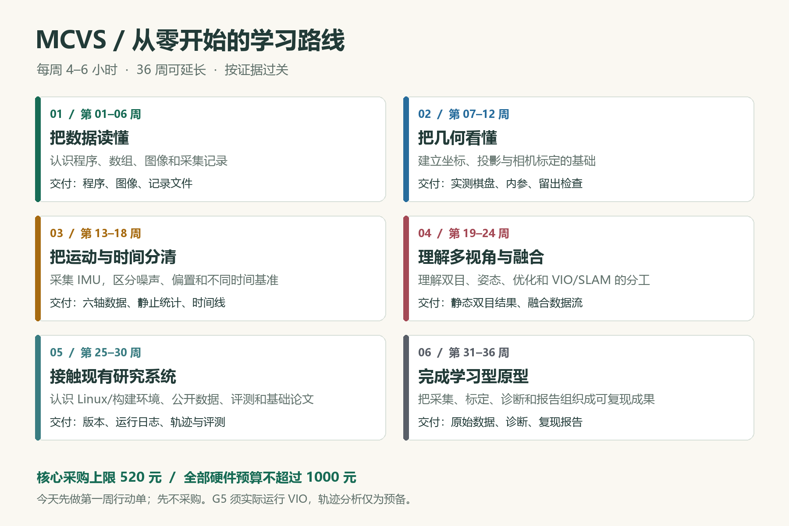

# MCVS 零基础学习入口

课程版本：2026-10-31；入口更新：2026-11-02。适用条件：理论基础较少，每周 4–6 小时，新增硬件总预算不超过 1000 元。

本次编制目标是完成一套可执行、可检查、可逐步修订的学习体系。你的学习目标是：从能读懂一张图像和一行传感器数据开始，逐步完成单相机标定、IMU 采集、时间戳诊断、静态双目练习和一个已有 VIO 示例，最终交付可复现的学习型原型报告。

**方案编制完成不代表你已经学完。** [学习进度表](progress.md) 从零开始，只有实际练习和证据满足标准才勾选。

2026-11-02 研究目标补充：计划在申请 2027 年中外合作办学硕士前积累论文或扎实研究成果。见 [申请前科研计划](../research/application_research_plan.md)。本学习路径与研究交替推进，申请前需要的成果不再全部后置到硕士入学后；36 周任务和学习关卡仍按实际能力验收。

## 从哪里开始

1. 今天：读 [第一周行动单](first_week.md)，完成 30 fps 的帧间隔计算，不需要先买设备。
2. 本周：运行 [第一个练习](examples/first_steps.py)，按行动单做三次修改并解释输出。
3. 每周：查 [36 周课程](curriculum.md)，用 [实验任务书](labs.md) 完成当前任务，在进度表填写证据。
4. 采购前：查 [硬件推荐与预算](hardware.md)，达到对应阶段再买。
5. 遇到术语：查 [基础知识手册](foundations.md)，再按 [资料导航](resources.md) 阅读对应原始资料。

## 多种阅读形式

| 形式 | 入口 | 适合什么时候用 |
|---|---|---|
| 一页路线图 | [学习路线图](assets/roadmap.png) | 看全局、安排阶段 |
| 可打印手册 | [学习路线与执行手册 PDF](MCVS_learning_guide.pdf) | 离线阅读、每周复盘、纸面打勾 |
| 逐周课程 | [curriculum.md](curriculum.md) | 决定本周学什么、做到什么程度 |
| 中文基础解释 | [foundations.md](foundations.md) | 补概念、算例、单位与误区 |
| 动手任务书 | [labs.md](labs.md) | 按步骤做实验并记录结果 |
| 学习进度 | [progress.md](progress.md) | 记录通过、未通过及补课任务 |
| 结课报告 | [report_template.md](report_template.md) | 把成果组织成可复现材料 |
| 可直接打印的棋盘 | [8×5 内角点、20 mm 格长棋盘](assets/checkerboard_8x5_20mm.pdf) | 第 11 周相机标定，打印后必须实测尺寸 |

## 为什么采用这条路线

| 学习方式 | 优点 | 对当前情况的取舍 |
|---|---|---|
| 理论优先 | 数学体系更完整，后续推导顺畅 | 零基础阶段反馈较慢，容易被线性代数和概率推导挡住 |
| 项目优先 | 很快看到摄像头、轨迹或地图 | 容易停留在运行程序，无法解释时间戳、尺度和误差 |
| 理论与实验交替 | 每个概念都有小实验，每个实验都补理论 | 本方案采用；每周保留解释、动手、记录和复盘四个环节 |

36 周是工作量安排，不是必须按日历赶完的承诺。按每周 4–6 小时估算，共约 144–216 小时。需要补课的周可以重复；停学后从最近未通过的关卡继续。

## 每周怎么分配 4–6 小时

- 60–90 分钟：读本地中文解释，再看一个指定小节或视频片段。
- 120–180 分钟：完成一个实验；一次只改变一个参数。
- 30–45 分钟：记录输入、单位、输出和异常。
- 30–45 分钟：闭卷解释、复算数值，更新进度和下一步。

如果只能投入 4 小时，先做必做项。拓展推导、第二台摄像头和 3D 重建均可后置。连续排错超过 2 小时仍无进展，就记录版本、命令与第一条错误，转到该实验的预备任务；预备任务不会自动算作正式关卡通过。

## 六个关卡

| 关卡 | 预期周次 | 必须拿得出的证据 |
|---|---:|---|
| G1 数据与程序 | 6 | 一个亲自修改过的小程序、输出记录、单位解释 |
| G2 相机标定 | 12 | 图像分组、实际格长、内参/畸变、留出数据检查 |
| G3 IMU 与时间 | 18 | 六轴 CSV、静止统计、时间基准图、同步未知量说明 |
| G4 多视角与融合 | 24 | 静态双目或公开样例结果、变换方向、VIO 数据流图 |
| G5 研究系统入门 | 30 | 一个实际运行的已有 VIO 示例、版本和日志、评测说明；仅分析现成轨迹时仍记为预备状态 |
| G6 学习型原型 | 36 | 可复现的数据、标定、诊断、报告、演示与边界说明 |

目标并不要求你在 36 周内独立推导完整 MSCKF、开发工业同步板或复现所有论文。熟练工程开发、严谨状态估计推导和生产级多相机系统是后续方向。

## 硬件与电脑

当前机器检测到 Windows 11、Ryzen 5 9600X、约 23 GiB 系统报告内存及 RTX 5070，可以沿用。这里只读取了配置概况，没有验证 CUDA、Linux 驱动或具体深度学习框架兼容性；前半程练习也不依赖 CUDA。

推荐基础组合：**已有电脑 + 一台普通 USB 摄像头 + XIAO nRF52840 Sense 板载 IMU + 标定棋盘和固定夹具**。按采购上限估算，核心部分 520 元；加上第二相机、额外夹具、可选万用表以及 160 元预留，总上限正好 1000 元。上限是预算控制值，不是已确认的国内成交价。

这个组合用于学习采集、标定与误差诊断。普通 USB 摄像头和独立开发板没有因此获得统一硬件时钟；自采数据不能直接被称为已同步、已完成 Camera-IMU 标定的 VIO 数据。

## 和原有资料怎么衔接

- 原来的 [硬件与系统方案调研](../hardware_scheme_research.md) 继续保留，遇到具体接口与系统路线时回查。
- 原来的 [技术路线](../technical_route.md) 是工程研发路线。当前学习路线先补它所需的编程、数学与测量基础。
- [论文索引](../papers.md) 在第 29 周后成为主资料；优先读 VersaVIS 和 OpenVINS，其他论文按研究问题选读。
- [中文全文翻译进度](../translation/README.md) 独立维护。本学习手册是原创中文教学整理，不是上述论文的完整译本。

## 如何持续完善

每六周只回答四个问题：哪些任务实际通过了；卡在哪些概念；设备或环境有哪些限制；下一阶段要删减或补充什么。修改课程时保留已经产生的实验记录，不为了追赶周数把未完成任务勾选为通过。

结构化课程数据在 [course.json](course.json)。可打印材料的构建工具在 [tools/build_materials.py](tools/build_materials.py)；重建材料不会覆盖你的学习进度与实验报告。
